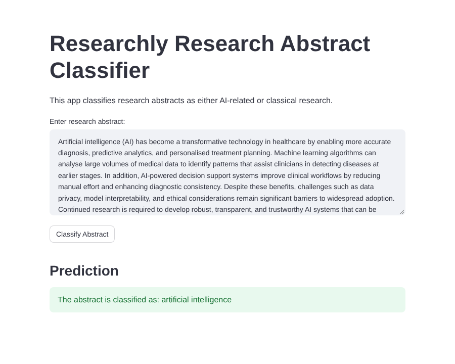

# Researchly: Research Paper Classification and Topic Analysis

ITNLP4-34 Natural Language Processing project in Python. The project answers four questions in one notebook, [notebooks/ITNPA4_34_Project.ipynb](notebooks/ITNPA4_34_Project.ipynb).

Questions 1 and 2 build a Research Papers Expert System. The system labels research abstracts as AI or classical research, improves on a Naive Bayes baseline and serves the best model through a Flask web app. Questions 3 and 4 mine five research articles. The notebook cleans the text, summarises the articles with TextRank and LSA, and models the topics with LDA and an interactive pyLDAvis map.



## Results

The Question 1 baseline, Bag of Words with Multinomial Naive Bayes, reaches 90.6% cross-validated accuracy and an AI-class F1 of 0.765. In Question 2, Linear SVM with SMOTE gives the best result, with 91.9% cross-validated accuracy and an AI-class F1 of 0.782. Question 3 reduces article 1 to a 6-sentence TextRank summary and articles 2 to 5 to a 12-sentence LSA summary across four themes. Question 4 finds 5 LDA topics with a C_v coherence of 0.5675.

## Repository structure

```
researchly-text-mining/
├── README.md
├── requirements.txt              packages for running the notebook locally
├── notebooks/
│   └── ITNPA4_34_Project.ipynb   Questions 1 to 4, with all outputs
├── data/
│   ├── research_abstracts.json   Questions 1 and 2: 1,138 labelled abstracts
│   ├── research_corpus.zip       Questions 3 and 4: five research articles
│   └── research_corpus/          the same articles, extracted
├── deployment/                   web app for the Question 1 and 2 design
│   ├── README.md                 deployment steps
│   ├── app.py
│   ├── preprocessing.py
│   ├── train_model.py
│   ├── templates/index.html
│   ├── models/best_model.pickle
│   ├── requirements.txt
│   └── Dockerfile
├── docs/
│   ├── Project_Documentation.md  documentation for Questions 1 to 4
│   └── images/                   figures from the notebook
└── outputs/
    └── lda_intertopic_distance_map.html   interactive pyLDAvis map
```

## Run the notebook

GitHub shows the notebook with all outputs and charts. To run the notebook yourself, open [Google Colab](https://colab.research.google.com), choose File and then Upload notebook, and pick notebooks/ITNPA4_34_Project.ipynb. Choose Runtime and then Run all. When the upload button appears, select research_abstracts.json and research_corpus.zip from the data folder together.

To run the notebook on your own computer, install the packages with pip install -r requirements.txt and open the notebook from the notebooks folder. The notebook finds both files in ../data.

## Run the web app

Open a terminal in the deployment folder, run pip install -r requirements.txt, then run python app.py and open http://127.0.0.1:5000 in your browser. The [deployment README](deployment/README.md) covers Colab, Docker and retraining.

## View the topic map

GitHub shows HTML files as code. Download outputs/lda_intertopic_distance_map.html and open the file in any browser. The map holds the JavaScript inside the file, so the map works offline.

## Documentation

[docs/Project_Documentation.md](docs/Project_Documentation.md) explains the methods, results and figures for every question, with Harvard references.

## Reference

Cuantum Technologies (2024) *Natural language processing with Python updated edition: from basics to advanced projects*. 2nd edn. Plano, TX: Cuantum Technologies LLC.
