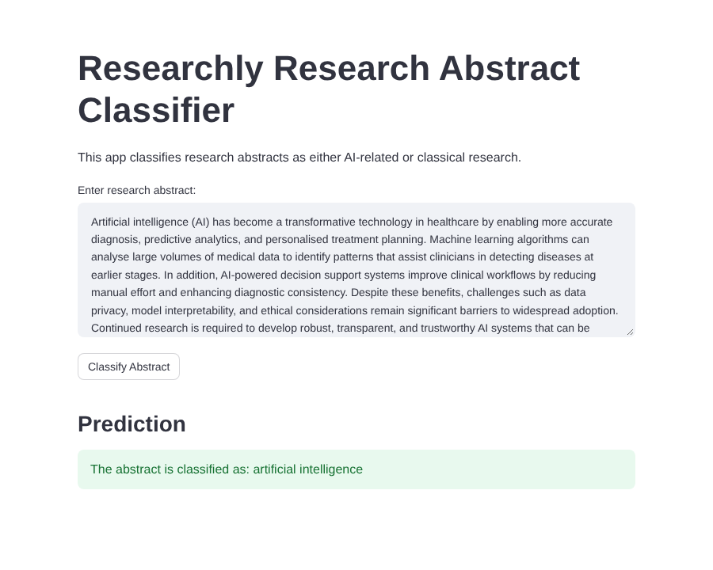

# Deployment: Researchly Research Abstract Classifier

This folder runs the Question 1 and 2 design as a Flask web app. The app cleans each abstract with the Question 1.1 pipeline and classifies the abstract with the best Question 2 model, TF-IDF then SMOTE then Linear SVM. The cleaning steps and model settings match notebooks/ITNPA4_34_Project.ipynb.



## Files

app.py holds the Flask app with the / and /classify routes. preprocessing.py holds the denoise_text and preprocess_text functions from Question 1.1, shared by the app and the training script. train_model.py rebuilds models/best_model.pickle from ../data/research_abstracts.json. templates/index.html holds the web page. requirements.txt lists the packages, with scikit-learn and imbalanced-learn pinned to the versions used to save the model. The Dockerfile runs the app in a container.

## Option 1: your own computer

You need Python 3.12 or newer. Open a terminal in this folder and run these commands.

```bash
python -m venv .venv
source .venv/bin/activate          # on Windows: .venv\Scripts\activate
pip install -r requirements.txt
python app.py
```

Open http://127.0.0.1:5000 in your browser, paste an abstract and click Classify Abstract. The first start downloads a few small NLTK data files, so you need an internet connection the first time.

## Option 2: Google Colab

Upload app.py, preprocessing.py, the templates folder and the models folder to the Colab Files panel, keeping the folder names. Then run this cell and click the printed link.

```python
!pip install -q scikit-learn==1.9.1 imbalanced-learn==0.14.2 flask
import subprocess, time
server = subprocess.Popen(['python', 'app.py'])
time.sleep(8)
from google.colab.output import eval_js
print(eval_js("google.colab.kernel.proxyPort(5000)"))
```

Section 2.3 of notebooks/ITNPA4_34_Project.ipynb also trains the model and starts the same app inside the notebook.

## Option 3: Docker

```bash
docker build -t researchly-app .
docker run -p 5000:5000 researchly-app
```

Open http://127.0.0.1:5000 in your browser.

## Retrain the model

Run python train_model.py in this folder if the model fails to load with your scikit-learn version, or if the data changes. The script prints the cross-validated scores and saves a new models/best_model.pickle.

```
Baseline: Naive Bayes (Q1)       5-fold CV accuracy = 0.906, F1 (ai) = 0.765
Best: Linear SVM + SMOTE (Q2)    5-fold CV accuracy = 0.919, F1 (ai) = 0.782
```

## Test without a browser

With the app running, send an abstract with curl. The reply page shows the prediction, artificial intelligence.

```bash
curl -X POST -d "abstract=We train deep neural networks to forecast stock returns." http://127.0.0.1:5000/classify
```
